<!-- 

<h3><code>kira-vik@github ~ $ ./contributions.sh</code></h3>

  

<h3><code>kira-vik@github ~ $ whoami</code></h3>
<table>
  <tr>
    <td valign="top"></td>
    <td valign="top"></td>
  </tr>
</table>

  

<h3><code>kira-vik@github ~ $ cat tech-stack.txt</code></h3>

                     

  

<h3><code>kira-vik@github ~ $ ./dev-quote.sh</code></h3>

 

 -->

<h3> 🌱 Proof I Don't Just Star Repos </h3>

  

<h3> 🕵️ Who Am I? (Asking for a Friend) </h3>

<table>
  <tr>
    <td valign="top"></td>
    <td valign="top"></td>
  </tr>
</table>
 

  

<h3> 🧰 Things I Break (and Occasionally Fix) </h3>

                     

  

<h3> 💬 Borrowed Wisdom, Randomly Dispensed </h3>

  

<h3> 📡 Let's Get in Touch (No Carrier Pigeons Required) </h3>

Got a messy dataset, a stubborn ETL pipeline, or an ERPNext module that won't behave? I'm friendlier than my stack traces.

